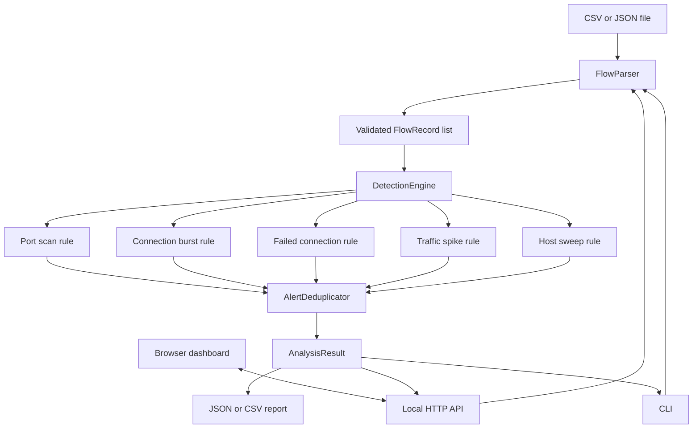

# How NetSentry is put together

NetSentry shares one parser and detection engine between its command-line interface and the browser dashboard. The dashboard sends requests to a small Java HTTP server included with the JDK; it does not need a separate frontend server.

## What happens during an analysis

1. `FlowParser` checks the file type and size, reads CSV or JSON, normalizes timestamps and enum-like fields, and validates each row.
2. Valid rows become `FlowRecord` objects. Invalid rows are counted and their error messages are added to the result, up to the parser's error-report limit.
3. `DetectionEngine` runs each enabled rule using the configuration loaded at startup. The allowlist is applied to source IP addresses.
4. `AlertDeduplicator` combines duplicate findings that share a rule, source, destination, and configured time bucket. It keeps the finding with the largest observed metric.
5. The engine returns an `AnalysisResult` with counts, alert details, configuration, and a traffic trend.
6. The CLI prints or saves the result. The API publishes the latest result to the dashboard and writes a separate history summary.

## State and saved files

The latest full analysis remains in memory while the server is running. It is not restored after a restart. History summaries and incident cases are saved separately as JSON files under `~/.netsentry/history` and `~/.netsentry/incidents`. Set the JVM property `netsentry.dataDir` to move both directories under another root. The original uploaded flow records are not stored in either folder.

## Boundaries and limitations

- Input files are data; NetSentry does not execute their contents.
- Sample analysis accepts only names from the bundled sample list, not arbitrary filesystem paths.
- Static dashboard files are served from the application's packaged web resources.
- The HTTP listener binds to loopback by default. There is no login or multi-user separation.
- NetSentry does not collect live packets, block traffic, alter firewall rules, or take response actions automatically.
- Host intelligence is built from the latest alert endpoints. It does not list every host in the source dataset.
- Alert correlations are recalculated from the latest alert set. They are investigation leads, not confirmed incidents.
